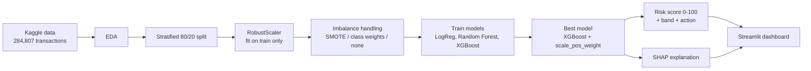
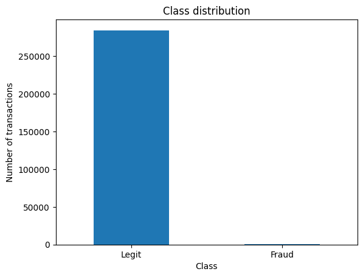
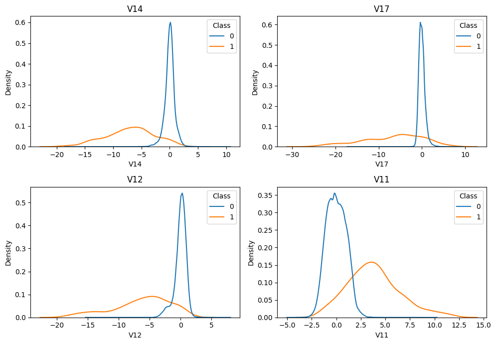
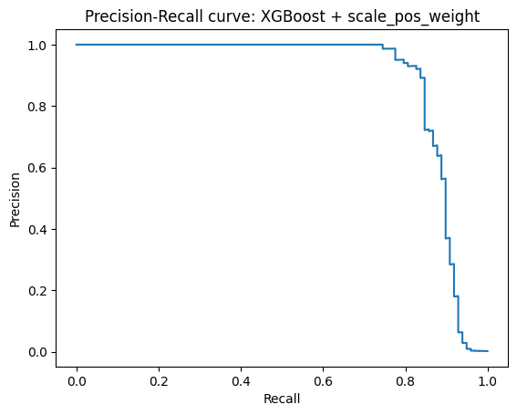
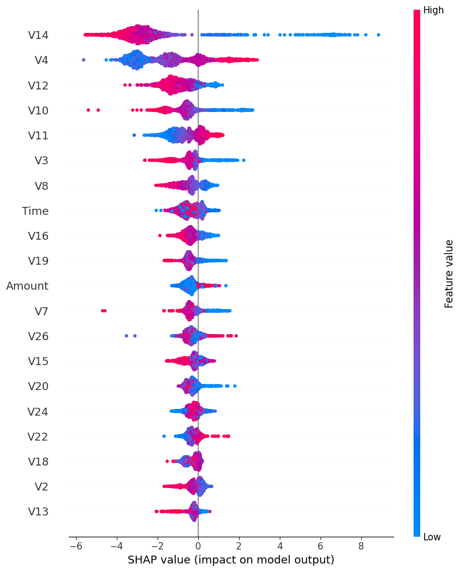
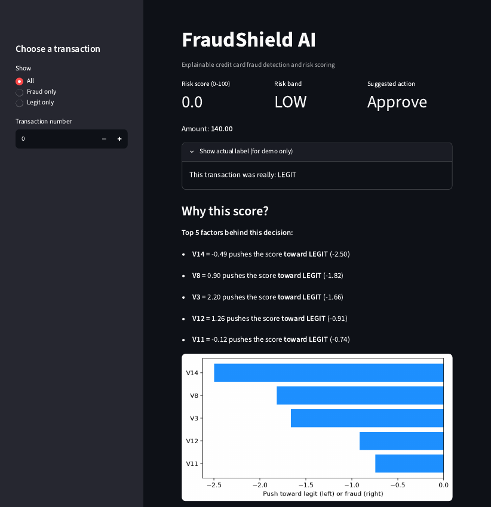
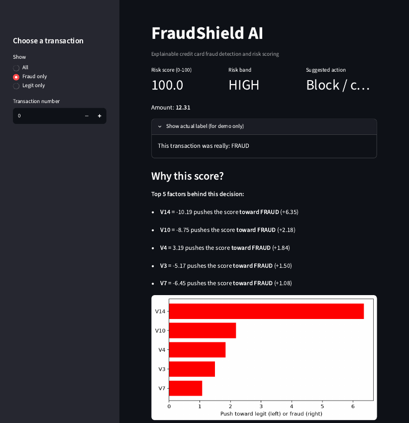

<div align="center">

# 🛡️ FraudShield AI

### Explainable credit card fraud detection and risk scoring

*Catches 83 of 98 frauds with only 10 false alarms, and tells you **why** every transaction was flagged.*

<br>

[](https://fraudshield-ai-surendra.streamlit.app)
[](https://colab.research.google.com/github/SurendraReddy7468/FraudShield-AI/blob/main/FraudShield_AI.ipynb)


### 👉 [**Open the live app**](https://fraudshield-ai-surendra.streamlit.app) 👈

</div>

---

## 📌 Table of Contents

- [Overview](#-overview)
- [Key Results](#-key-results)
- [Features](#-features)
- [How It Works](#-how-it-works)
- [Dataset](#-dataset)
- [Methodology](#-methodology)
- [Results in Detail](#-results-in-detail)
- [Explainability with SHAP](#-explainability-with-shap)
- [App Screenshots](#-app-screenshots)
- [Project Structure](#-project-structure)
- [Run It Yourself](#-run-it-yourself)
- [Limitations](#-limitations)
- [Future Work](#-future-work)
- [Tech Stack](#-tech-stack)
- [Author and Acknowledgements](#-author-and-acknowledgements)

---

## 🔍 Overview

Credit card fraud is rare but expensive. In the dataset used here, only **492 of 284,807 transactions (0.17%)** are fraud, so a model that always answers *"legit"* is **99.83% accurate while catching zero fraud**. Accuracy is the wrong yardstick for this problem.

**FraudShield AI** is built around that fact. It:

1. compares three models and three ways of handling imbalance, judged by **precision, recall, F1 and PR-AUC**,
2. turns the best model's output into a **0 to 100 risk score** with an action (**Approve, Review or Block**),
3. explains each decision with **SHAP**, so a human can see which features pushed the score, and
4. delivers everything in an interactive **Streamlit** dashboard that runs on real, held-out transactions.

> 🎓 Capstone project for the **SURE ProEd (SURE Trust)** internship, Machine Learning track.

---

## 🏆 Key Results

Final model: **XGBoost with `scale_pos_weight`**, evaluated on **56,962 unseen test transactions (98 frauds)**.

| Metric | Score |
|---|---|
| **Precision** | **0.893** |
| **Recall** | **0.847** |
| **F1-score** | **0.869** |
| **PR-AUC** | **0.885** |
| ROC-AUC | 0.967 |
| Frauds caught | **83 of 98** |
| False alarms | **10** out of 56,864 legit transactions |

**Confusion matrix**

|  | Predicted legit | Predicted fraud |
|---|:---:|:---:|
| **Actual legit** | 56,854 | 10 |
| **Actual fraud** | 15 | 83 |

---

## ✨ Features

- 📊 **Imbalance-aware evaluation**: precision, recall, F1 and PR-AUC instead of accuracy.
- 🧪 **Fair experiment**: SMOTE, class weights and no handling compared on the same split.
- 🚦 **Risk score and bands**: a 0 to 100 score mapped to *Low / Medium / High* with a suggested action.
- 🧠 **Explainable decisions**: top five factors for every transaction, plus a full SHAP waterfall.
- 🖥️ **Interactive dashboard**: filter by *All / Fraud only / Legit only* and browse real held-out transactions.
- 🔒 **No data leakage**: scaler fitted on training data only; SMOTE applied after the split and only on training data.

---

## ⚙️ How It Works



Training happens offline in Google Colab. The model, scaler and feature list are saved with `joblib` and loaded by the Streamlit app, together with `sample_transactions.csv`, a sample of **398 real held-out transactions** (all 98 test frauds plus 300 random legit ones). The app therefore only shows data the model **never trained on**.

---

## 🗂️ Dataset

| | |
|---|---|
| **Source** | [Credit Card Fraud Detection](https://www.kaggle.com/datasets/mlg-ulb/creditcardfraud) (Kaggle, ULB Machine Learning Group) |
| **Size** | 284,807 transactions, 31 columns, collected over 48 hours |
| **Fraud** | 492 transactions (**0.17%**) |
| **Features** | `V1` to `V28` (PCA-anonymised), `Time`, `Amount` |
| **Target** | `Class` (0 = legitimate, 1 = fraud) |
| **Missing values** | None |

> The raw `creditcard.csv` is not stored in this repository because of its size. Download it from Kaggle to rerun the notebook.

**What the exploration showed**

- Fraud tends to be **small**: median amount **9.25** vs **22.00** for legit, so amount alone cannot detect it.
- `V17`, `V14`, `V12` and `V10` are the strongest negative correlates of fraud (about -0.33, -0.30, -0.26, -0.22).
- Legit activity follows a daily rhythm, while fraud arrives in bursts and continues at night.

<p align="center">
  
  &nbsp;
  
</p>

---

## 🧪 Methodology

| Step | What was done |
|---|---|
| **1. Split** | Stratified 80/20, `random_state=42`: 227,845 train (394 frauds) and 56,962 test (98 frauds) |
| **2. Scale** | `RobustScaler` on `Amount` and `Time`, **fit on train only** |
| **3. Handle imbalance** | **SMOTE** (train only, 50/50), **class weights**, and a **no-handling control** |
| **4. Models** | Logistic Regression, Random Forest (100 trees), XGBoost (300 trees, depth 6, lr 0.1) |
| **5. Class weight** | `scale_pos_weight = 577.29` (legit / fraud ratio in training) |
| **6. Evaluate** | Precision, recall, F1, ROC-AUC and **PR-AUC** at a 0.5 cut-off |
| **7. Explain** | SHAP values for global and per-transaction explanations |

---

## 📈 Results in Detail

### Full model comparison

| Model | Precision | Recall | F1 | ROC-AUC | PR-AUC |
|---|:---:|:---:|:---:|:---:|:---:|
| Logistic Regression + SMOTE | 0.059 | 0.918 | 0.111 | 0.971 | 0.725 |
| Random Forest + SMOTE | 0.845 | 0.837 | 0.841 | 0.973 | 0.870 |
| XGBoost + SMOTE | 0.737 | 0.857 | 0.793 | 0.980 | 0.871 |
| Logistic Regression + class weight | 0.061 | 0.918 | 0.114 | 0.972 | 0.718 |
| Random Forest + class weight | 0.960 | 0.735 | 0.832 | 0.948 | 0.860 |
| **XGBoost + `scale_pos_weight`** | **0.893** | **0.847** | **0.869** | 0.967 | **0.885** |
| XGBoost (no handling) | 0.940 | 0.796 | 0.862 | 0.963 | 0.849 |

**Takeaways**

- 🌲 Tree models clearly beat Logistic Regression, which catches 91.8% of fraud but with a precision near **0.06** (roughly 1,400 false alarms).
- 📉 **ROC-AUC is 0.95 to 0.98 for every model**, even the weak ones. It hides the differences, which is why **PR-AUC** is used to choose the winner.
- ❌ **SMOTE did not help.** Training on 50/50 data makes the model over-flag real data where fraud is 0.17%. Class weighting gave the best F1 and PR-AUC.

### Choosing the cut-off

| Cut-off | Precision | Recall | Flagged |
|:---:|:---:|:---:|:---:|
| 0.1 | 0.822 | 0.847 | 101 |
| 0.3 | 0.874 | 0.847 | 95 |
| **0.5** | **0.892** | **0.847** | **93** |
| 0.7 | 0.891 | 0.837 | 92 |
| 0.9 | 0.931 | 0.827 | 87 |

### Risk bands

The risk score is the predicted probability multiplied by 100. It is a **ranking**, not a calibrated probability.

| Band | Probability | Transactions | Fraud rate | Action |
|---|---|---:|---:|---|
| 🟢 **Low** | below 0.02 | 56,834 | 0.02% | Approve |
| 🟡 **Medium** | 0.02 to 0.5 | 35 | 8.57% | Review |
| 🔴 **High** | 0.5 or above | 93 | 89.25% | Block |

The fraud rate climbs about **4,500 times** from Low to High, and **83 of the 93** High-band transactions are real fraud. Only the small Medium band needs a human reviewer.

<p align="center">
  
</p>

---

## 🧠 Explainability with SHAP

Every score comes with its reasons. The strongest drivers across the dataset are **V14, V4, V12, V10 and V11**; low values of V14, V12 and V10 push the score toward fraud.

Because `V1` to `V28` are anonymised, the app shows *which* features matter, not *what they mean*.

<p align="center">
  
</p>

---

## 🖼️ App Screenshots

Pick a held-out transaction and the app shows its **risk score, band, suggested action, the true label (demo only) and the top five reasons**.

| ✅ Legitimate transaction | 🚨 Fraudulent transaction |
|:---:|:---:|
|  |  |
| Amount 140.00 → score **0.0**, band **LOW**, action **Approve** | Amount 12.31 → score **100.0**, band **HIGH**, action **Block** |

> One real fraud was scored **3 (LOW)** and approved by mistake. Its features look completely normal, so no model could separate it. 12 of the 98 test frauds fall in the Low band. This is documented honestly under [Limitations](#-limitations).

---

## 📁 Project Structure

```
FraudShield-AI/
├── app.py                    # Streamlit dashboard
├── FraudShield_AI.ipynb      # Full analysis and training notebook (Colab)
├── fraud_model.pkl           # Trained XGBoost model (joblib)
├── fraud_model.json          # Same model in XGBoost's native format
├── scaler.pkl                # RobustScaler fitted on the training set
├── feature_names.pkl         # Column order expected by the model
├── sample_transactions.csv   # 398 real held-out transactions for the demo
├── requirements.txt          # Python dependencies
├── assets/                   # Images used in this README
└── README.md
```

---

## 🚀 Run It Yourself

**1. Clone the repository**

```bash
git clone https://github.com/SurendraReddy7468/FraudShield-AI.git
cd FraudShield-AI
```

**2. Create a virtual environment and install dependencies**

```bash
python -m venv venv
# Windows
venv\Scripts\activate
# macOS / Linux
source venv/bin/activate

pip install -r requirements.txt
```

**3. Launch the app**

```bash
streamlit run app.py
```

The dashboard opens at `http://localhost:8501`.

**Re-train the model (optional).** Download `creditcard.csv` from [Kaggle](https://www.kaggle.com/datasets/mlg-ulb/creditcardfraud) and run `FraudShield_AI.ipynb` in Google Colab or Jupyter.

---

## ⚠️ Limitations

- **Small test fraud count.** Only 98 frauds are in the test set, so small differences between models are not reliable.
- **Slightly optimistic scores.** The cut-off was explored on the test set. A separate validation set would be cleaner.
- **Some fraud is invisible.** 12 test frauds look completely normal and receive a very low score.
- **Anonymised features.** `V1` to `V28` can be ranked but not interpreted in business terms.
- **Single dataset.** Results may not carry over to other banks, regions or time periods.
- **Demo, not production.** The app runs on a sample file, not a real-time transaction stream.

---

## 🔭 Future Work

- [ ] Choose the cut-off with cross-validation and a separate validation set.
- [ ] Calibrate probabilities so the risk score becomes a true probability.
- [ ] Add feature engineering such as the hour of day.
- [ ] Replace the demo sample with a real-time prediction API.
- [ ] Test on newer and larger data to check generalisation.

---

## 🧰 Tech Stack

| Area | Tools |
|---|---|
| Language | Python |
| Data | Pandas, NumPy |
| Modelling | Scikit-learn, XGBoost, imbalanced-learn |
| Explainability | SHAP |
| Visualisation | Matplotlib, Seaborn |
| App | Streamlit |
| Workflow | Google Colab, VS Code, Git and GitHub |

---

## 👤 Author and Acknowledgements

**Surendra Reddy**
GitHub: [@SurendraReddy7468](https://github.com/SurendraReddy7468)

Built as a capstone project during the **SURE ProEd (SURE Trust)** internship, *Skill Upgradation for Rural youth Empowerment Trust*. Thanks to my mentor **Ms. Akshara A** for her guidance, and to **Prof. Radhakumari Challa**, Executive Director and Founder of SURE Trust.

Dataset: Machine Learning Group, Université Libre de Bruxelles (ULB), via Kaggle.

---

<div align="center">

If you found this project useful, please consider giving it a ⭐

</div>
